<p align="center">
  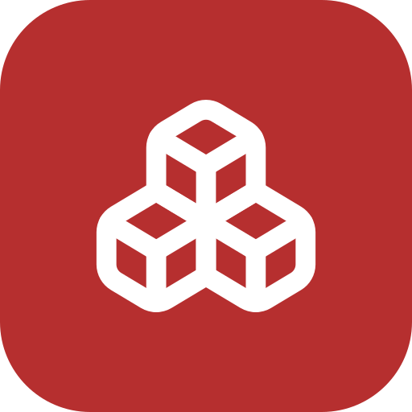
</p>

<h1 align="center">InventoryCore</h1>

<p align="center">
  <strong>Self-hosted inventory and inspection management for fire brigades, rescue services and every team that has to know where its equipment is and whether it works.</strong>
</p>

InventoryCore keeps track of your assets, where they are, what condition they are in and when they are due for inspection. Scan a label with a hand scanner or your phone camera, run an inventory of a vehicle, record a yearly check, print new labels – all in one web app that runs on your own server.

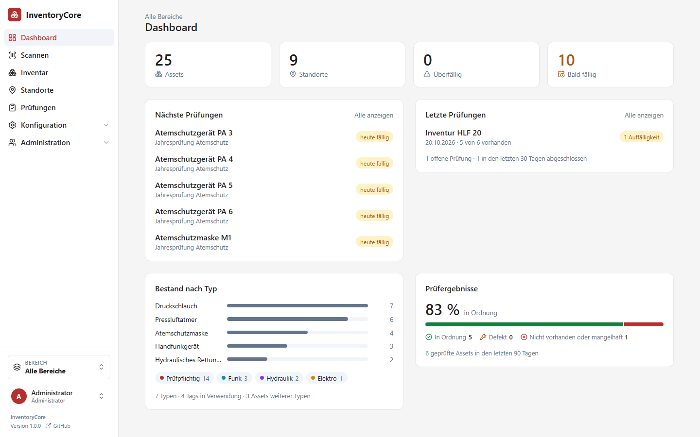

## Highlights

- **Everything about an asset in one place** – type with custom fields, location, tags, status, images, linked assets and the full history.
- **Scan anything** – QR, Data Matrix, barcodes; with a USB hand scanner or the phone camera, including small Data Matrix codes lasered into black plastic.
- **Inspections that plan themselves** – recurring checks per asset type, due dates on the dashboard, inventories by location and protocols you can print.
- **Status with history** – Available, Defect, In repair, In delivery, Missing, Retired, plus your own; completed inspections set them automatically.
- **Areas and permissions** – separate departments (breathing protection, vehicles, quartermaster …) with fine-grained group rights, LDAP and single sign-on.
- **Labels** – design your own label layouts and print them for one or hundreds of assets.
- **Runs anywhere** – one Docker image plus PostgreSQL, installable as an app on phones and tablets, light and dark mode.

## Features

### Inventory

Assets, nested locations (site → building → room → vehicle → compartment), asset types with their own fields, tags and areas. Lists can be searched and filtered by area, status, tag, location and type, and shown as a list, as tiles or as a tree of linked assets. Every list remembers the view you chose.

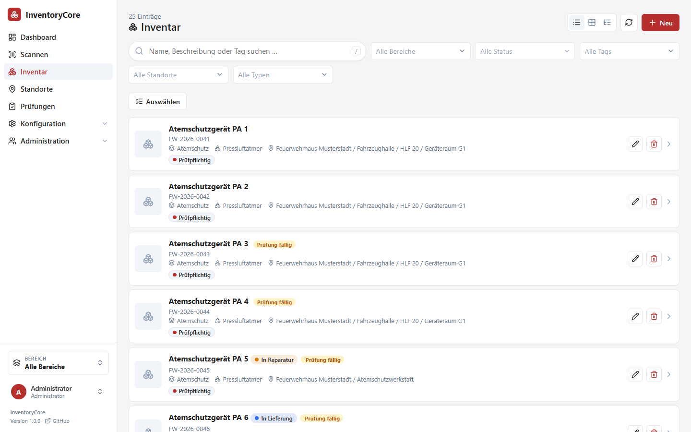

Each asset page shows its details, typed custom fields (numbers, dates, yes/no, selections), its status with a full change history, inspection due dates, linked parent and child assets, images and the activity log. Data sheets can be printed for one asset or a whole selection.

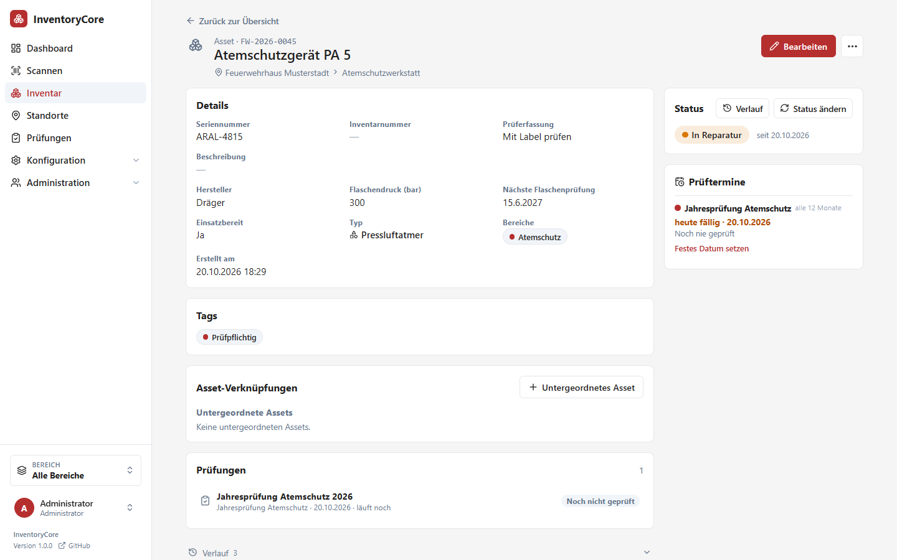

### Asset status

Six built-in statuses cover the usual cases; each area can add its own (for example "Lent out" or "At the manufacturer"). A status carries a behavior: retired assets are shown grey and are no longer inspected, defect or missing assets return to "Available" when an inspection passes. Every change is stored with comment, author and – when an inspection set it – a link to the protocol.

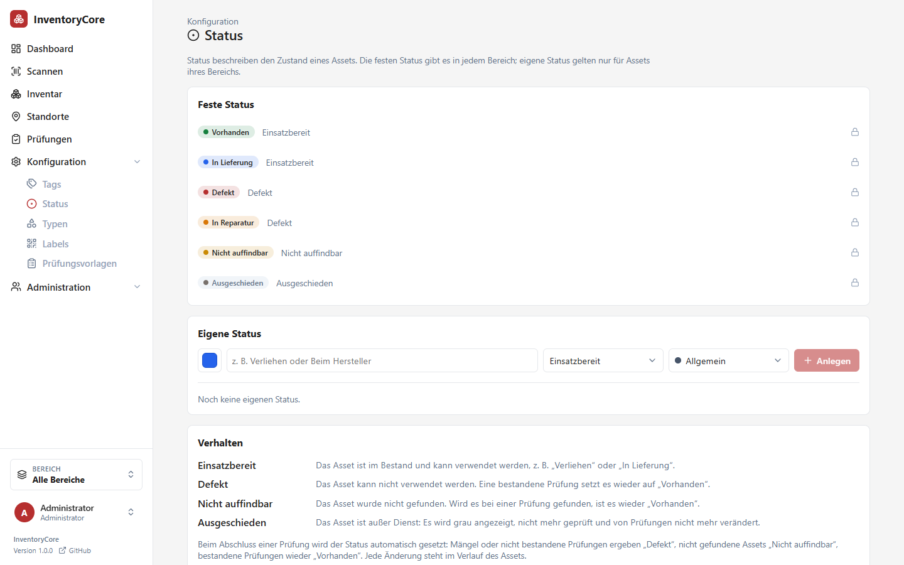

### Scanning

The scan page finds assets and locations by link, ID, inventory ID, inventory number or serial number. It works with any hand scanner that types the code and presses Enter, and with the camera of a phone or tablet. The camera reader handles QR, Data Matrix, Aztec, PDF417 and the common barcodes – also light-on-dark codes lasered into plastic – with zoom and torch where the device supports it. Ambiguous codes show every match.

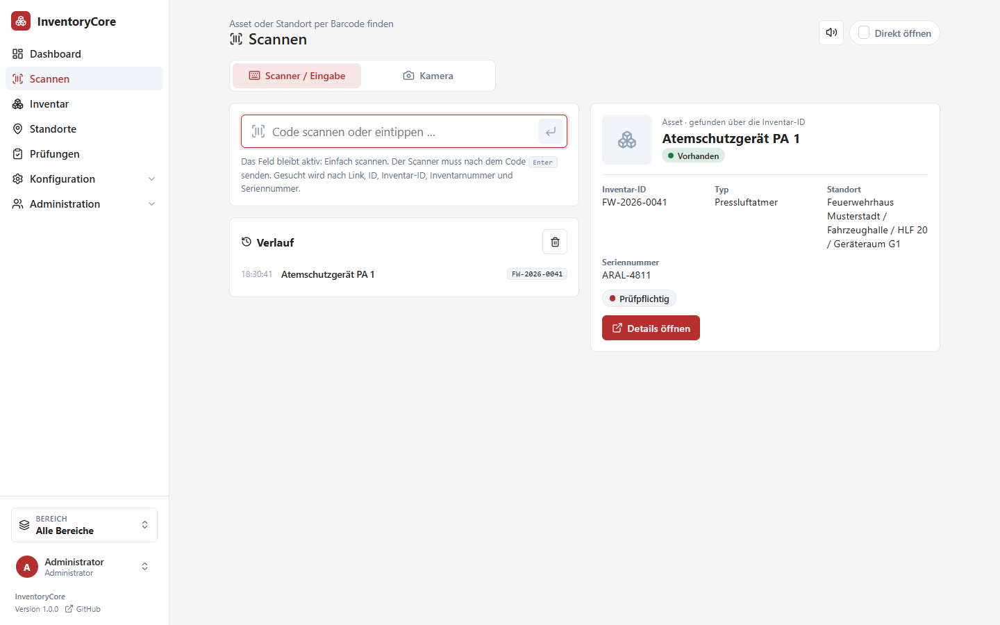

<p align="center">
  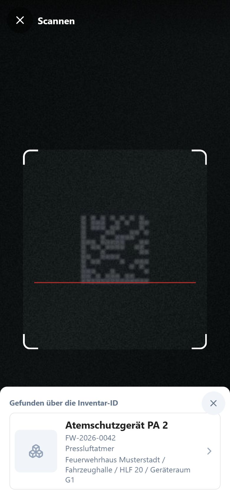
  &nbsp;&nbsp;
  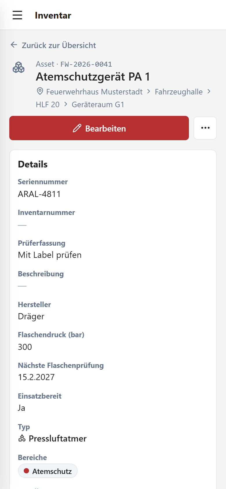
</p>

### Inspections

Inspection templates define what is checked, for which asset types, how often and with which fields. There are two kinds of runs:

- **Inventory** – the expected assets come from location, type, tag and area filters; scanning marks them present, everything else counts as missing or as foreign objects.
- **Check** – single devices are checked as in order or defective, with the template's fields, notes and photos.

Recurring due dates appear on the dashboard and on every asset. Completed protocols can be printed with signature lines and set the asset status automatically.

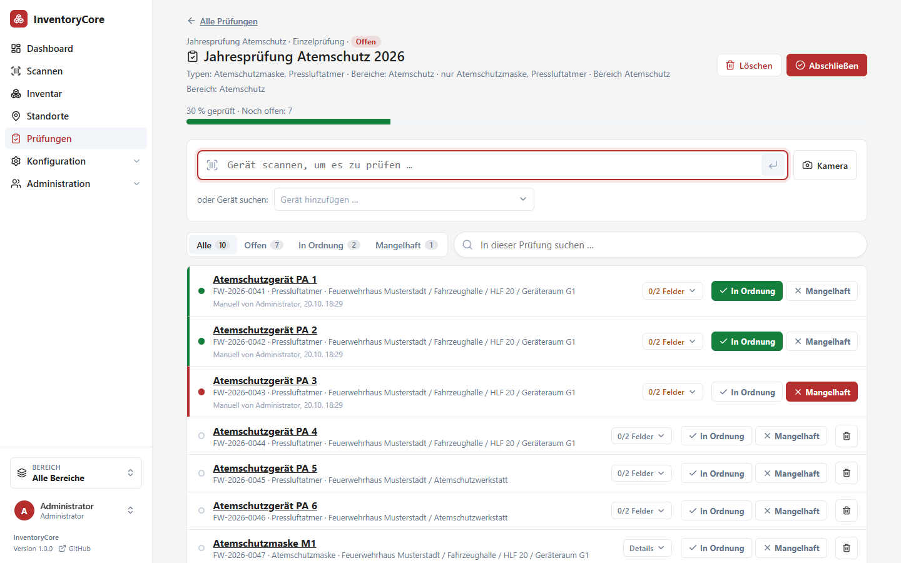

### Labels

A visual editor for label templates per area: QR codes and barcodes, text with placeholders such as `{name}`, `{invId}` or `{location}`, logos and frames, in any size. Print labels for single assets or a selection.

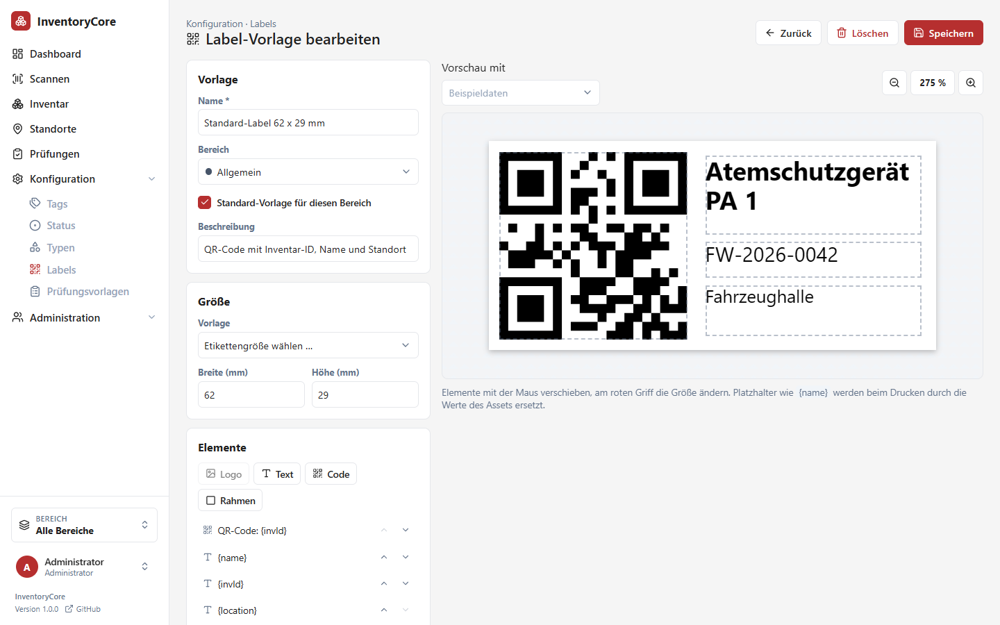

### Areas, permissions and sign-in

- **Areas** separate departments. Assets, locations and types belong to one or more areas; the sidebar switches between them.
- **Group permissions** grant view, create, edit, inspect, delete or admin rights per area and object kind. A built-in group "All users" gives everyone basic rights.
- **Shared locations** let several areas use one store room while each only sees its own things.
- **Sign-in** with local accounts, LDAP / Active Directory (with scheduled user and group sync) or OpenID Connect single sign-on, optionally redirecting straight to the identity provider.
- **Activity log** records every change, plus sign-ins, failed sign-ins and sign-outs with IP address and browser; admins see a user's sign-in history on the user page.

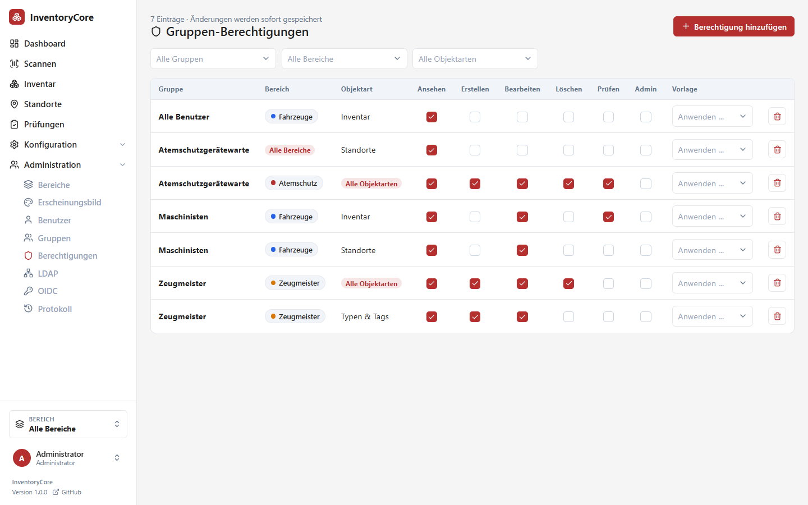

### Made for daily use

- Dashboard per area: due and overdue inspections, recent protocols, inventory by type, inspection results.
- Installable as a progressive web app; works well on phones and tablets.
- Light mode by default, dark mode or following the system on request; your own logo, name and colors.
- Formal German user interface; all texts are loaded from a translation file, so further languages can be added without rebuilding.

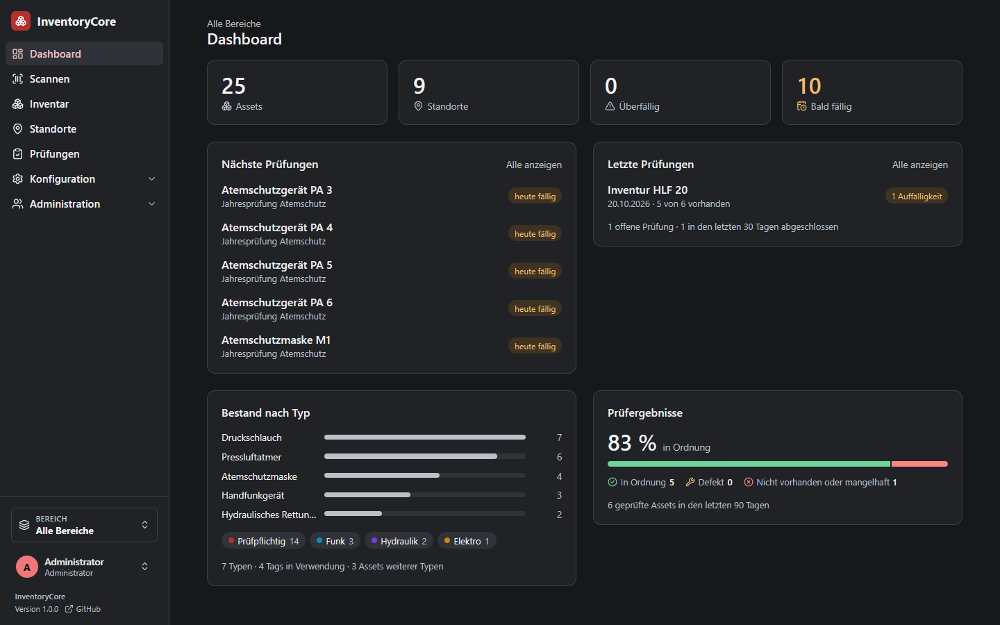

## Quick start

InventoryCore ships as one Docker image (`ghcr.io/jpromi/inventorycore`) that contains the web app and the server. It needs PostgreSQL, which the provided Compose file starts next to it.

```sh
mkdir inventorycore && cd inventorycore
curl -O https://raw.githubusercontent.com/JPromi/inventorycore/main/deploy/docker-compose.yml
curl -o .env https://raw.githubusercontent.com/JPromi/inventorycore/main/deploy/.env.example
# change the passwords in .env, then
docker compose up -d
```

Open `http://<your-server>:8080` and sign in with the admin account from `.env` (default `inv` / `core` – change it). Updates are a `docker compose pull && docker compose up -d`; the database is migrated in place. Run it behind an HTTPS reverse proxy: browsers only allow camera scanning over HTTPS. Details: [deployment guide](docs/DEPLOYMENT.md).

## Technology

| Part | Built with |
| --- | --- |
| Web app | Angular 21, TypeScript, Leaflet maps, zxing-wasm camera reader |
| Server | Spring Boot 4, Java 21, Spring Security (sessions, LDAP, OIDC) |
| Database | PostgreSQL |
| Delivery | One container image built by GitHub Actions (`latest`, `beta` and version tags) |

## Documentation

| Topic | Read |
| --- | --- |
| Components and request flow | [Architecture](docs/ARCHITECTURE.md) |
| Setup and everyday work | [Development](docs/DEVELOPMENT.md) |
| Build commands and artifacts | [Build](docs/BUILD.md) |
| Tests and known gaps | [Testing](docs/TESTING.md) |
| HTTP contracts | [API](docs/API.md) |
| Persistence and schema updates | [Database](docs/DATABASE.md) |
| Authentication and permissions | [Security](docs/SECURITY.md) |
| Running in production, Docker image | [Deployment](docs/DEPLOYMENT.md) |
| Coding, styling, and language | [Conventions](docs/CONVENTIONS.md) |
| Architectural decision process | [Decision records](docs/decisions/README.md) |

Contributors start with [local development](docs/DEVELOPMENT.md); AI coding agents with [AGENTS.md](AGENTS.md). The screenshots above are generated with example data: `frontend/screenshots/seed.mjs` fills an empty instance and `npm run screenshots` (in `frontend/`) takes them again.

---

© JPromi
